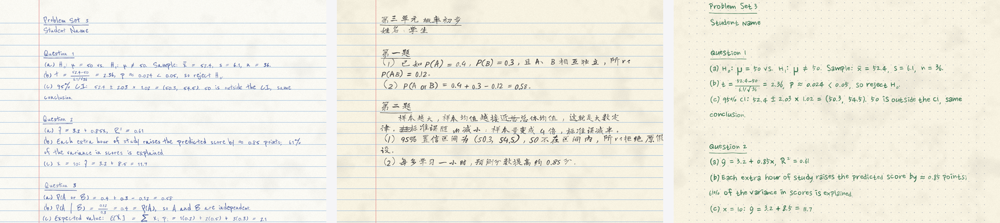

# Handwrite

把 Word / PDF / 文本作业拖进来，变成像真人用圆珠笔写在纸上的 PDF。
全程在你自己的电脑上完成，不联网、不上传。

Drop a Word, PDF or text file; get pages that look hand-written with a ballpoint pen.
Runs entirely offline.



## 下载

到 [Releases](https://github.com/yuanshengbo8-sketch/handwrite-app/releases/latest) 下载对应的文件：

| 电脑 | 下载 |
|---|---|
| Windows 10 / 11 | `Handwrite.exe`，双击即用，不用安装 |
| Mac（M1 / M2 / M3 / M4 芯片） | `Handwrite-macOS-AppleSilicon.zip` |
| Mac（Intel 芯片，大约 2020 年以前） | `Handwrite-macOS-Intel.zip` |

不知道 Mac 是哪种芯片：点左上角苹果 →「关于本机」，"芯片"写 Apple M 开头的选 AppleSilicon，"处理器"写 Intel 的选 Intel。

**Mac 首次打开**：解压后把 Handwrite 拖进「应用程序」。因为没有付费签名，第一次双击会提示"无法验证开发者"：
打开「系统设置 → 隐私与安全性」，往下拉找到 Handwrite，点「仍要打开」。
如果提示"已损坏，无法打开"，在「终端」里运行一次下面这行再打开：

```bash
xattr -cr /Applications/Handwrite.app
```

## 使用

1. 打开 Handwrite。
2. 把文件拖进窗口，或点「打开文件」。
3. 右侧用 ‹ › 调：10 种纸张、10 种纸质、10 款字迹、10 种笔色、潦草程度 1–10，还有笔压、字号、倾斜、字距、词距、涂改痕迹、扫描感。
4. 「换一种笔迹」生成一套新的书写习惯（每个字母固定的倾斜和大小），「重新排一版」换一种排布。
5. 「导出 PDF」。要打印就把「扫描感」关掉。

切到「文字」可以修改要写的内容。格式：`# ` 开头是标题，空行空一行，行首空格缩进，
`x^2` 上标，`H_{2}O` 下标，`\frac{1}{n}` 叠式分数，`\sum_{i=1}^{n}` 带上下限的 Σ，`\hat{x}` `\bar{x}` 帽子和横线。

首次打开时 Windows 会提示「Windows 已保护你的电脑」，点「更多信息 → 仍要运行」。
这是因为安装包没有花钱签名，不是病毒；不放心的话可以从源码自己打包，
或者看 [Actions](https://github.com/yuanshengbo8-sketch/handwrite-app/actions) 里公开的构建过程。
第一次启动要解压 2–3 秒，等窗口出现再拖文件。

## 从源码运行

```bash
pip install -r requirements.txt
python app/main.py          # 原生窗口
python app/main.py --web    # 在浏览器里打开 http://127.0.0.1:8791
python build.py             # 打包成 exe / app
```

## 为什么看起来像真人写的

每个字母单独画：各自的倾斜、大小、笔画弯曲、墨色轻重，再叠一套这个"人"固定的书写习惯；
字母之间偶尔连笔，长单词越写越懒，行尾挤字而不是换行，偶尔写错划掉重写。
字体是 10 款 SIL OFL 开源手写体（`app/fonts/`）。

## 许可

代码 MIT，字体各按其 OFL 许可证。
